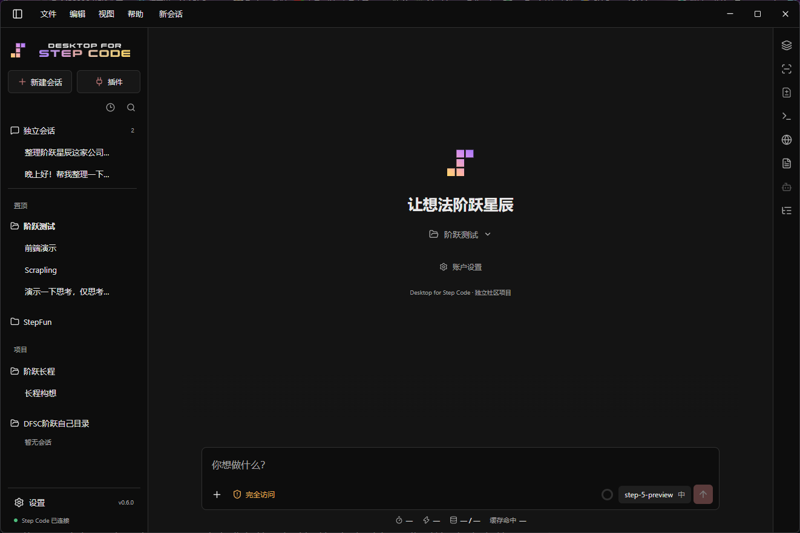

<p align="center">
  
</p>
<br>
<p align="center">
  
</p>
<hr>
<p align="center">Let ideas reach the stars.</p>
<p align="center">A third-party Step Code desktop workspace for Windows x64 and macOS Apple Silicon.</p>
<p align="center"><a href="README.md">English</a> · <a href="README.zh-CN.md">简体中文</a></p>
<p align="center"><a href="https://github.com/7oMB2006/desktop-for-step-code/releases/latest"><strong>Download for Windows or macOS</strong></a> · <a href="https://calm-falcon-0dc2.page.stepcloud.com/">Product showcase (Chinese)</a></p>
<p align="center">
  
</p>

A community-built client for [Step Code](https://github.com/stepfun-ai/Step-Code), not a StepFun product. Desktop brings projects, conversations and tools into one workspace; Step Code runs the Agent and owns its execution permission policies.

### Download and Run

Get the installer and SHA-256 checksums from the [latest stable release](https://github.com/7oMB2006/desktop-for-step-code/releases/latest).

| Platform | Installation | Checksum file |
| --- | --- | --- |
| Windows x64 | Run the `Desktop.for.Step.Code.Setup.<version>.exe` installer. | `SHA256SUMS.txt` |
| macOS Apple Silicon (13.5+) | Unzip the ARM64 archive and move the app to Applications. | `SHA256SUMS-macos-arm64.txt` |

The Windows installer is unsigned; the Mac app is not Developer ID signed or notarized. Verify the downloaded file against its checksum without disabling system protections. No Intel Mac or Linux installer is provided for v1.0.0.

Launch the app, sign in under Account with Step Plan or a Step Platform API key, or configure a custom provider (Beta). Open a project or start an independent conversation and choose a model. The app bundles Electron, Step Code and Node; Git/Bash, project tools and MCP server dependencies are separate when needed.

For upgrades, open **Settings → About**. Supported installations can download in the app and restart to install after you confirm; other builds can use the release page. Finish tasks and quit the old app before a manual upgrade. Upgrade in place without uninstalling or removing app data. See [Updates](docs/UPDATES.md).

### Features

- Streaming conversations, model and thinking-level selection
- Custom providers (Beta), model discovery, capability settings and connection diagnostics
- Independent sessions and project workspaces, ordering, pinning, archiving and branching, plus [full-text search with message navigation](docs/SESSION_SEARCH.md)
- Concurrent sessions, queued sends, steering, quotes and cross-session links
- Image attachments, tool approvals, subagent status and elapsed-time feedback
- Plan review and execution, Goal controls, and Ultracode workflow inspection and explicit recovery
- CLM context maintenance, inline commands and links, and persistent turn-status controls
- Summary, context and diff inspection, with bounded recorded-change undo
- A terminal, file previews and delivery references
- [Built-in browser with Playwright](docs/BROWSER_AUTOMATION_PLAN.md) for Agent-led web testing without opening a foreground system browser. You can share an existing tab for viewing or filling ordinary fields, but not submission.
- Step account sign-in, MCP configuration, and resource discovery
- [Community plugin marketplace](docs/CAPABILITIES.md#community-marketplace) for plugins and themes, with a manually added source and a GitHub submission path
- Built-in MiniChat, continuous dictation, settings search and global custom instructions
- Chinese and English UI, with light and dark themes
- GitHub update checks and notifications, with selectable release channels
- Background tray operation and window restoration
- Font and size settings for the interface, messages, code and Diff, plus message line spacing

### Data and Troubleshooting

Desktop uses `%APPDATA%\Desktop for Step Code` on Windows and `~/Library/Application Support/Desktop for Step Code/` on macOS, not your personal Step Code CLI profile. Windows user encryption or macOS Keychain-backed encryption protects the saved Step credentials; it does not protect against arbitrary software running as the same user. Signing out clears the saved Step credentials. Check the `logs/` subdirectory for crash reports before reinstalling. Concurrent sessions do not provide file locks or transaction isolation.

Open **Settings → Plugins → Installed → StepPage** to prepare the official bundle explicitly with bundled Node. Setup does not run silently or copy a personal StepPage profile. See [StepPage setup and limits](docs/STEPPAGE.md).

Custom providers use Chat Completions, Responses or Anthropic Messages. Model behavior varies by provider; a successful connection check alone does not verify tool use, streaming, image input or long tasks.

### Build from Source

Windows instructions follow. For a native Apple Silicon build and package verification, see the [macOS guide](docs/MACOS.md).

Requirements: Windows x64, Git, Node.js 24.16.0 and Corepack. Avoid Node.js 24.0 through 24.15 on Windows: their TCP-connect path can crash the process (nodejs/node#63620). Before building, fetch the pinned Step Code upstream revision in the repository root and apply the Windows/Desktop integration patch maintained here.

Run these commands in PowerShell from the repository root:

```powershell
git clone https://github.com/stepfun-ai/Step-Code.git Step-Code
git -C Step-Code checkout --detach 5309624e5deff3d8fee031f0853fe7e07bc68801
node scripts/apply-step-code-desktop-patch.mjs Step-Code patches\v018\step-code-desktop.patch

Push-Location Step-Code
corepack pnpm install --frozen-lockfile
corepack pnpm build:offline
Pop-Location

Push-Location Desktop
corepack pnpm install --frozen-lockfile
node node_modules/electron/install.js
corepack pnpm stage:runtime
corepack pnpm typecheck
corepack pnpm test
corepack pnpm build
node scripts/verify-electron.mjs
corepack pnpm dev
```

Both v1.0.0 builds use the reviewed Step Code `v018` source baseline and `patches/v018/`. This pin does not identify an upstream GitHub Release or prove a match with an upstream binary. See [runtime integration](docs/UPSTREAM_V018.md).

To produce a Windows x64 installer:

```powershell
corepack pnpm package
node scripts/checksums.mjs
```

### Project Status

See the [Development TODO](TODO.md) (Chinese) for planned work and priorities.

See the [release record](docs/RELEASE.md) and [verification evidence](docs/VERIFICATION.md) for shipped scope and acceptance limits. Fixture coverage does not establish compatibility with every provider, site or real account.

### License

Desktop for Step Code is licensed under MIT. Step Code and its Pi upstream components retain their respective licenses and notices.
