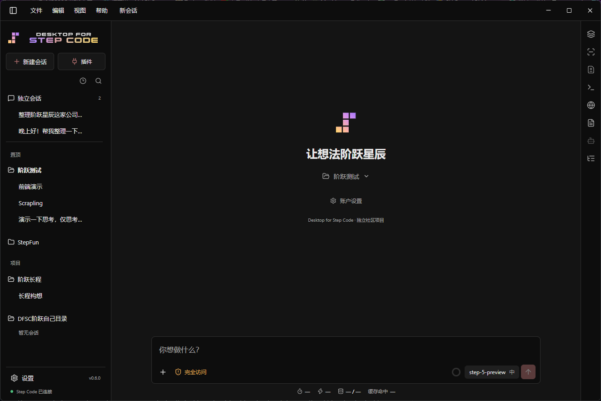

<p align="center">
  
</p>
<br>
<p align="center">
  
</p>
<hr>
<p align="center">让想法阶跃星辰。</p>
<p align="center">Windows x64 · macOS Apple Silicon · Electron · React · TypeScript · MIT</p>
<p align="center"><a href="README.md">English</a> · <a href="README.zh-CN.md">简体中文</a></p>
<p align="center"><a href="https://calm-falcon-0dc2.page.stepcloud.com/"><strong>访问产品展示站</strong></a> · 动态演示、下载安装与开发者介绍</p>
<p align="center">
  
</p>

一个支持 Windows x64 与 macOS Apple Silicon 的社区 [Step Code](https://github.com/stepfun-ai/Step-Code) 桌面客户端。它提供桌面工作区、对话和会话管理，Agent 执行由 Step Code 提供。

### 项目初衷

项目最初的想法，是在 StepFun 官方尚未正式推出 Step Code Desktop 的窗口期，尝试开发一个社区版 Desktop；鉴于我对阶跃星辰的喜爱，我也期待 StepFun 早日发布官方版本！

### 功能

- 流式对话、模型与思考等级选择
- 自定义供应商（Beta）、模型发现、能力配置与连接诊断
- 独立会话和项目工作区，排序、置顶、归档与会话分支
- 并发会话、排队与插队引导、文本引用和跨会话链接
- 图片附件、工具调用确认、子代理状态和耗时反馈
- Plan 批阅与执行、Goal 管理、Ultracode 编排观察与显式恢复
- Cron 定时任务管理、会话关联与显式恢复（Beta）
- CLM 上下文维护、修订浏览与修改对比
- 本机用量热力图、趋势统计与官方账户消耗估算
- 插件市场来源、MCP 与 Skills 管理，会话导入与左栏搜索
- 行内指令与链接、常驻轮次尾态
- 摘要、上下文与 Diff 检查，记录改动的有限撤销
- 内置终端、用户操作的浏览器、文件预览与交付产物引用
- Step 账户登录、MCP 配置与资源发现
- 中英文界面和明暗主题
- GitHub 新版检查、可选更新通道与受支持安装方式的应用内更新
- 后台托盘运行与窗口恢复
- 界面、正文、代码与 Diff 的字体和字号设置，正文行距调整

桌面端使用单独的应用数据目录（Windows 为 `%APPDATA%\Desktop for Step Code`，macOS 为 `~/Library/Application Support/Desktop for Step Code/`），不复用个人 Step Code CLI 配置。Step Code 提供 Agent 执行与权限策略，Desktop 提供会话编排和桌面交互；并发协作不等于文件锁或事务隔离。

Windows 的 Step 登录凭据使用当前用户的加密存储机制保存到 `step-runtime/auth.dpapi`。已有桌面端 `auth.json` 会在启动时迁移并移除明文文件；Windows 卸载会清除桌面端 Step 凭据，但保留会话、设置和独立工作区文件，退出登录也会清除 Step 凭据。macOS 使用 Electron safeStorage 与 Keychain，详见 [macOS 说明](docs/MACOS.md)。这不能防护同一用户身份下运行的其他软件；MCP 配置中的密钥不属于这次迁移范围。

StepPage 在设置的内置插件区域提供显式准备、校验和重试入口，MCP 页面提供跳转。文件及独立 HOME 保存在 Desktop 数据目录，使用随包 Node 启动；不安装全局 shell 包装、不读取个人 CLI 登录、不静默启用已禁用服务或重启会话。Windows 登录与发布的专项验收及 Mac 握手证据分别记录，不互相外推，见 [StepPage 适配与边界](docs/STEPPAGE.md)。

若应用启动失败或 Step Code 运行时意外退出，日志会写入 `%APPDATA%\Desktop for Step Code\logs\crash-<timestamp>-<id>.log`。日志位于应用数据目录，重装不会清除；排查时先查看最新日志。

### 下载与运行

**v0.6.0** 已于 2026-10-25 发布为 Windows x64 与 macOS Apple Silicon 联合社区预览版。重点为 **Cron 定时任务管理与恢复 Beta**、**CLM 工作上下文及修订查看**，另含本机用量统计、插件／MCP／Skills 管理、会话迁移与搜索、切换性能和面板体验优化。两端使用 Step Code v0.1.5 对应固定源码基线 `b5dbed93`；自定义供应商继续为 Beta。

**[下载 Windows x64 安装包](https://github.com/7oMB2006/desktop-for-step-code/releases/download/v0.6.0/Desktop.for.Step.Code.Setup.0.6.0.exe)** · **[下载 macOS ARM64 ZIP](https://github.com/7oMB2006/desktop-for-step-code/releases/download/v0.6.0/Desktop.for.Step.Code.0.6.0.arm64.zip)** · [版本说明与校验值](https://github.com/7oMB2006/desktop-for-step-code/releases/tag/v0.6.0) · [所有版本](https://github.com/7oMB2006/desktop-for-step-code/releases)

1. 下载对应平台文件，使用 Release 的 `SHA256SUMS.txt` 核对 SHA-256。Windows 运行安装器；Mac 解压后将应用放入可写的 Applications 目录，要求 Apple Silicon、macOS 13.5+。
2. 启动应用，在账户设置中使用自己的 Step Plan 账户或 Step Platform API Key 登录，或配置自定义供应商。
3. 打开本地项目或选择独立会话，选择模型后开始对话。

安装包包含 Electron、固定版本的 Step Code 和 Node 运行时，无需安装下方的开发依赖。Git/Bash、项目专用工具以及 MCP 服务端依赖需另行安装；模型使用资格与额度由你的账户决定。

**自定义供应商（Beta）：** 通过通用协议配置支持 Chat Completions、Responses 和 Anthropic Messages。兼容性取决于供应商和模型；短请求诊断通过不代表流式输出、工具调用、图片输入或长任务均已验证。后续针对知名供应商的专配目前优先级不高，暂无时间承诺。

**安装提示：** Windows 安装器未进行数字签名，可能显示 SmartScreen 或“未知发布者”提示；Mac 应用无 Developer ID 签名、未公证，可能需要 Gatekeeper 安全确认。请核对下载来源与哈希，不要关闭或绕过系统安全防护。

**后续更新：** 启动后自动检查，此后每六小时复查，也可在“设置 → 版本更新”中手动检查或关闭自动检查。默认通道包含正式版与预览版；**v0.6.0 为 GitHub Pre-release，仅正式版通道不会提示本版。** 受支持的 Windows NSIS 安装版可在应用内下载、校验并确认重启安装；`win-unpacked` 解压预览版和开发模式不启用该安装流程，需手动下载。Mac 的应用内更新要求可写安装位置，受 Gatekeeper 等限制；旧版是否可直接升级取决于其更新器支持。详见 [更新说明](docs/UPDATES.md)，不会自动下载或未经确认安装。

**退出与升级：** 关闭窗口会保留应用在托盘中，运行中的任务继续执行。升级前先结束任务，通过“文件 → 退出应用”或托盘菜单明确退出旧版，再运行安装器覆盖安装。

本版支持 Windows x64 和 macOS Apple Silicon；不提供 Intel Mac、Linux 或 WSL 兼容承诺。从源码运行请参阅下方 Windows 步骤或 [macOS 构建说明](docs/MACOS.md)。

### 从源码构建

需要 Windows x64、Git、Node.js 24.16.0 和 Corepack。Windows 上请避开 Node.js 24.0 至 24.15：其 TCP 连接路径可能导致进程崩溃（nodejs/node#63620）。构建前需在仓库根目录获取固定版本的 Step Code 上游代码，并应用本仓库维护的 Windows/Desktop 集成补丁。

在仓库根目录的 PowerShell 中运行：

```powershell
git clone https://github.com/stepfun-ai/Step-Code.git Step-Code
git -C Step-Code checkout b5dbed938d9ae589397cf522dcf2ff89ecf4c494
node scripts/apply-step-code-desktop-patch.mjs Step-Code patches\v015\step-code-desktop.patch

Push-Location Step-Code
corepack pnpm install --frozen-lockfile
corepack pnpm build
Pop-Location

Push-Location Desktop
corepack pnpm install --frozen-lockfile
node node_modules/electron/install.js
corepack pnpm stage:runtime
corepack pnpm typecheck
corepack pnpm test
corepack pnpm build
node scripts/verify-electron.mjs
corepack pnpm dev
```

已发布 v0.6.0 的两端包使用上述 v0.1.5 钉点与 `patches/v015/` 集成；macOS 另加 Darwin 进程树清理补丁，见 [macOS 说明](docs/MACOS.md)。构建新版不改变旧版已发布包的来源。

生成 Windows x64 安装程序：

```powershell
corepack pnpm package
node scripts/checksums.mjs
```

### 当前状态

后续功能与优先级见 [开发待办](TODO.md)。

v0.6.0 仍是社区预览版，不是 StepFun 官方产品，也不代表稳定版承诺。双端包均从干净提交 `195f10f` 构建并完成交叉复核；维护者已确认最终包体验和所要求的 Windows 全新安装／覆盖升级检查无问题。自动化覆盖、原失败与续跑边界见 [最终发布记录](docs/releases/v0.6.0-published.zh-CN.md)。这些结果不等于所有付费模型、系统版本、供应商或 MCP 场景均已验证，也不代表内置更新的公网下载至重启安装链路已经完整实测。

具体验收记录与发布范围见 [VERIFICATION.md](docs/VERIFICATION.md) 和 [发布准备记录](docs/RELEASE.md)。摘要板展示运行时实际提供的 MCP 连接状态；配置启用不等于连接健康，也不代表实际业务调用成功。

### 许可

Desktop for Step Code 源码采用 MIT 许可证。Step Code 及其 Pi 上游组件保留各自许可证和版权声明。

### macOS Apple Silicon

v0.6.0 已与 Windows 共用同一 Release，保留原生 Command 快捷键、zsh、Dock／菜单栏和 Keychain。下载入口见上方；构建、可写安装目录和未签名限制见 [macOS 说明](docs/MACOS.md)，最终来源与验收见 [发布记录](docs/releases/v0.6.0-published.zh-CN.md)。早期候选和平台交接文档保留为历史，不代表当前发布状态。
