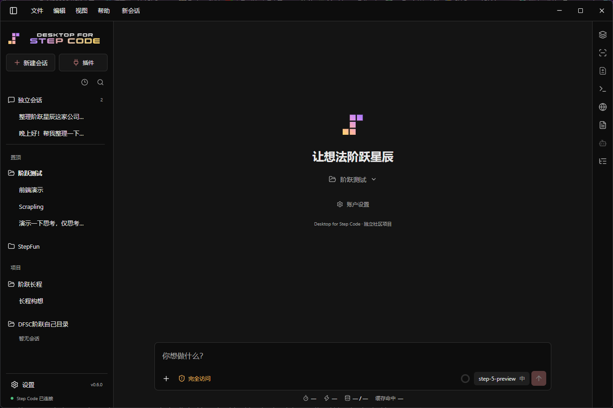

<p align="center">
  
</p>
<br>
<p align="center">
  
</p>
<hr>
<p align="center">让想法阶跃星辰。</p>
<p align="center">面向 Windows x64 和 macOS Apple Silicon 的第三方 Step Code 桌面工作区。</p>
<p align="center"><a href="README.md">English</a> · <a href="README.zh-CN.md">简体中文</a></p>
<p align="center"><a href="https://github.com/7oMB2006/desktop-for-step-code/releases/latest"><strong>下载 Windows 或 macOS 版</strong></a> · <a href="https://calm-falcon-0dc2.page.stepcloud.com/">产品展示站</a></p>
<p align="center">
  
</p>

这是社区开发的 [Step Code](https://github.com/stepfun-ai/Step-Code) 桌面客户端，不是阶跃星辰官方产品。Desktop 把项目、会话和工具集中在一个工作区，Agent 执行及其权限策略由 Step Code 提供。

### 下载与运行

从[最新正式版](https://github.com/7oMB2006/desktop-for-step-code/releases/latest)下载对应平台的安装包与 SHA-256 校验文件。

| 平台 | 安装方式 | 校验文件 |
| --- | --- | --- |
| Windows x64 | 运行 `Desktop.for.Step.Code.Setup.<version>.exe` 安装器。 | `SHA256SUMS.txt` |
| macOS Apple Silicon（13.5+） | 解压 ARM64 ZIP，将应用拖到「应用程序」。 | `SHA256SUMS-macos-arm64.txt` |

Windows 安装器未签名，Mac 应用未使用 Developer ID 签名，也未公证。请核对安装包哈希，不要关闭系统安全防护。v1.0.0 不提供 Intel Mac 或 Linux 安装包。

启动后在「账户」中使用自己的 Step Plan 或 Step Platform API Key 登录，也可配置自定义供应商（Beta）。打开项目或新建独立会话，选择模型后即可开始。安装包内置 Electron、Step Code 和 Node；Git/Bash、项目工具及 MCP 服务端依赖按需另装。

升级入口在**设置 → 关于**。符合条件的安装版可在应用内主动下载，确认后重启安装；其他构建可从发布页手动下载。手动升级前先结束任务并退出旧版，直接覆盖安装，无须先卸载或删除资料。详见[更新说明](docs/UPDATES.md)。

### 功能

- 流式对话、模型与思考等级选择
- 自定义供应商（Beta）、模型发现、能力配置与连接诊断
- 独立会话和项目工作区，排序、置顶、归档与会话分支，支持[全文搜索并定位原消息](docs/SESSION_SEARCH.md)
- 并发会话、排队与插队引导、文本引用和跨会话链接
- 图片附件、工具调用确认、子代理状态和耗时反馈
- Plan 批阅与执行、Goal 管理、Ultracode 编排观察与显式恢复
- CLM 上下文维护、行内指令与链接、常驻轮次尾态
- 摘要、上下文与 Diff 检查，记录改动的有限撤销
- 内置终端、文件预览与交付产物引用
- [内置浏览器与 Playwright](docs/BROWSER_AUTOMATION_PLAN.md)：Agent 验收网页不用打开前台系统浏览器；可共享原标签供查看或填写普通字段，不代提交
- Step 账户登录、MCP 配置与资源发现
- [社区插件市场](docs/CAPABILITIES.md#community-marketplace)：手动添加来源后可发现插件和主题，也可通过 GitHub 投稿
- 原生 MiniChat、连续语音听写、设置搜索与全局自定义指令
- 中英文界面和明暗主题
- GitHub 新版检查与更新提示，支持选择更新通道
- 后台托盘运行与窗口恢复
- 界面、正文、代码与 Diff 的字体和字号设置，正文行距调整

### 资料与排查

Windows 使用 `%APPDATA%\Desktop for Step Code`，macOS 使用 `~/Library/Application Support/Desktop for Step Code/`，不复用个人 Step Code CLI 配置。保存的 Step 凭据分别使用 Windows 当前用户或 macOS 钥匙串支持的机制加密，不能防护同一用户身份下运行的任意软件。退出登录会清理已保存的 Step 凭据。遇到启动或运行时崩溃，重装前可先查看资料目录下的 `logs/`。并发协作不提供文件锁或事务隔离。

在「设置 → 插件 → 已安装 → StepPage」可主动准备官方 bundle，并由随包提供的 Node 运行。不会静默安装或复制个人 StepPage 资料，详见 [StepPage 准备与限制](docs/STEPPAGE.md)。

自定义供应商支持 Chat Completions、Responses 和 Anthropic Messages 通用协议。连接诊断通过不代表长任务、工具调用、图片输入或流式输出都兼容。

### 从源码构建

下方是 Windows 构建步骤。Apple Silicon 原生构建与包校验见 [macOS 指南](docs/MACOS.md)。

需要 Windows x64、Git、Node.js 24.16.0 和 Corepack。Windows 上请避开 Node.js 24.0 至 24.15：其 TCP 连接路径可能导致进程崩溃（nodejs/node#63620）。构建前需在仓库根目录获取固定版本的 Step Code 上游代码，并应用本仓库维护的 Windows/Desktop 集成补丁。

在仓库根目录的 PowerShell 中运行：

```powershell
git clone https://github.com/stepfun-ai/Step-Code.git Step-Code
git -C Step-Code checkout --detach 5309624e5deff3d8fee031f0853fe7e07bc68801
node scripts/apply-step-code-desktop-patch.mjs Step-Code patches\v018\step-code-desktop.patch

Push-Location Step-Code
corepack pnpm install --frozen-lockfile
corepack pnpm build:offline
Pop-Location

Push-Location Desktop
corepack pnpm install --frozen-lockfile
node node_modules/electron/install.js
corepack pnpm stage:runtime
corepack pnpm typecheck
corepack pnpm test
corepack pnpm build
node scripts/verify-electron.mjs
corepack pnpm dev
```

v1.0.0 两端均使用审查过的 Step Code `v018` 源码基线与 `patches/v018/`。该钉点不等于上游 GitHub Release，也不证明与上游二进制逐字节对应。见[运行时集成说明](docs/UPSTREAM_V018.md)。

生成 Windows x64 安装程序：

```powershell
corepack pnpm package
node scripts/checksums.mjs
```

### 当前状态

后续功能与优先级见 [开发待办](TODO.md)。

发布范围和验收边界见[发布记录](docs/RELEASE.md)和[验收记录](docs/VERIFICATION.md)。隔离夹具通过不代表所有供应商、站点或真实账户都已验收。

### 许可

Desktop for Step Code 源码采用 MIT 许可证。Step Code 及其 Pi 上游组件保留各自许可证和版权声明。
