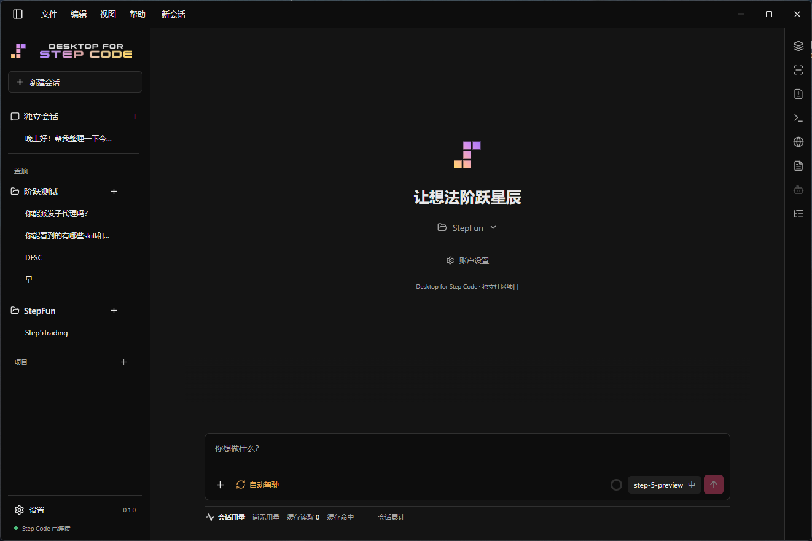

<p align="center">
  
</p>
<br>
<p align="center">
  
</p>
<hr>
<p align="center">让想法阶跃星辰。</p>
<p align="center">Windows x64 · Electron · React · TypeScript · MIT</p>
<p align="center"><a href="README.md">English</a> · <a href="README.zh-CN.md">简体中文</a></p>
<p align="center"><a href="https://calm-falcon-0dc2.page.stepcloud.com/"><strong>访问产品展示站</strong></a> · 动态演示、下载安装与开发者介绍</p>
<p align="center">
  
</p>

一个面向 Windows 的 [Step Code](https://github.com/stepfun-ai/Step-Code) 桌面客户端。它提供桌面工作区、对话和会话管理，Agent 执行由 Step Code 提供。

### 项目初衷

项目最初的想法，是在 StepFun 官方尚未正式推出 Step Code Desktop 的窗口期，尝试开发一个社区版 Desktop；鉴于我对阶跃星辰的喜爱，我也期待 StepFun 早日发布官方版本！

### 功能

- 流式对话、模型与思考等级选择
- 自定义供应商（Beta）、模型发现、能力配置与连接诊断
- 独立会话和项目工作区，排序、置顶、归档与会话分支
- 并发会话、排队与插队引导、文本引用和跨会话链接
- 图片附件、工具调用确认、子代理状态和耗时反馈
- Plan 批阅与执行、Goal 管理、Ultracode 编排观察与显式恢复
- CLM 上下文维护、行内指令与链接、常驻轮次尾态
- 摘要、上下文与 Diff 检查，记录改动的有限撤销
- 内置终端、用户操作的浏览器、文件预览与交付产物引用
- Step 账户登录、MCP 配置与资源发现
- 中英文界面和明暗主题
- GitHub 新版检查与更新提示，支持选择更新通道
- 后台托盘运行与窗口恢复
- 界面、正文、代码与 Diff 的字体和字号设置，正文行距调整

桌面端使用单独的应用数据目录（`%APPDATA%\Desktop for Step Code`），不复用个人 Step Code CLI 配置。Step Code 提供 Agent 执行与权限策略，Desktop 提供会话编排和桌面交互；并发协作不等于文件锁或事务隔离。

Step 登录凭据使用当前 Windows 用户的加密存储机制保存到 `step-runtime/auth.dpapi`。已有桌面端 `auth.json` 会在启动时迁移并移除明文文件；卸载会清除桌面端 Step 凭据，但保留会话、设置和独立工作区文件，退出登录也会清除 Step 凭据。这不能防护同一 Windows 用户身份下运行的其他软件；MCP 配置中的密钥不属于这次迁移范围。

内置的 StepPage MCP 服务在 Windows 上不可用：上游注册的 command 是一个 shell 包装，Windows 无法直接启动它；官方安装途径同样是 shell 脚本，上游代码在 Windows 上也明写跳过自动安装。桌面端探测到 `%USERPROFILE%\.steppage-mcp\bin\` 下的官方 bundle 时会自动注册一个可用的配置，command 指向随包暂存的 Node 运行时，args 指向该 bundle，认证沿用 Step 登录，无需额外配置 key。向 StepPage 实际发布未验收。

若应用启动失败或 Step Code 运行时意外退出，日志会写入 `%APPDATA%\Desktop for Step Code\logs\crash-<timestamp>-<id>.log`。日志位于应用数据目录，重装不会清除；排查时先查看最新日志。

### 下载与运行

最新 Windows x64 社区预览版 **v0.4.0** 已发布，锚定上游 Step Code v0.1.4 公告对应源码基线 `3ba89e0c`，纳入 Ultracode 恢复、CLM 上下文维护和 Windows 命令执行改进；桌面端适配三档权限、权限审批与 Plan 批阅抽屉，完善 Plan、Goal、Ultracode 行进态与常驻尾态，并优化指令集与行内链接。自定义供应商继续为 Beta。

**[下载 Windows x64 安装包](https://github.com/7oMB2006/desktop-for-step-code/releases/download/v0.4.0/Desktop.for.Step.Code.Setup.0.4.0.exe)** · [版本说明与校验值](https://github.com/7oMB2006/desktop-for-step-code/releases/tag/v0.4.0) · [所有版本](https://github.com/7oMB2006/desktop-for-step-code/releases)

1. 下载安装包，按照版本说明核对 SHA-256，再运行安装器。
2. 启动应用，在账户设置中使用自己的 Step Plan 账户或 Step Platform API Key 登录，或配置自定义供应商。
3. 打开本地项目或选择独立会话，选择模型后开始对话。

安装包包含 Electron、固定版本的 Step Code 和 Node 运行时，无需安装下方的开发依赖。Git/Bash、项目专用工具以及 MCP 服务端依赖需另行安装；模型使用资格与额度由你的账户决定。

**自定义供应商（Beta）：** 通过通用协议配置支持 Chat Completions、Responses 和 Anthropic Messages。兼容性取决于供应商和模型；短请求诊断通过不代表流式输出、工具调用、图片输入或长任务均已验证。后续针对知名供应商的专配目前优先级不高，暂无时间承诺。

**安装提示：** v0.4.0 安装器未进行数字签名，Windows 可能显示 SmartScreen 或“未知发布者”提示。请核对下载来源与哈希，不要关闭系统安全防护。

**后续更新：** 自 v0.2.0 起支持启动后自动检查新版，此后每六小时复查，也可在“设置 → 版本更新”中手动检查或关闭自动检查。默认通道包含正式版与预览版；**v0.4.0 标为 GitHub Pre-release，仅正式版通道不会提示本版。** 下载通过系统浏览器完成，安装包需自行运行，不会静默安装或自动重启。v0.1.0 用户需要手动到 [Releases](https://github.com/7oMB2006/desktop-for-step-code/releases) 下载此次升级。

**退出与升级：** 关闭窗口会保留应用在托盘中，运行中的任务继续执行。升级前先结束任务，通过“文件 → 退出应用”或托盘菜单明确退出旧版，再运行安装器覆盖安装。

本版面向 Windows x64，不提供 macOS、Linux 或 WSL 兼容承诺。从源码运行请参阅下方构建步骤。

### 从源码构建

需要 Windows x64、Git、Node.js 24.15.0（或兼容的 Node.js `>=22.19`）和 Corepack。构建前需在仓库根目录获取固定版本的 Step Code 上游代码，并应用本仓库维护的 Windows/Desktop 集成补丁。

在仓库根目录的 PowerShell 中运行：

```powershell
git clone https://github.com/stepfun-ai/Step-Code.git Step-Code
git -C Step-Code checkout 3ba89e0cbfe6be78cccdafb5aeafd2592177cbb8
node scripts/apply-step-code-desktop-patch.mjs ..\Step-Code patches\step-code-desktop.patch

Push-Location Step-Code
corepack pnpm install --frozen-lockfile
corepack pnpm build
Pop-Location

Push-Location Desktop
corepack pnpm install --frozen-lockfile
node node_modules/electron/install.js
corepack pnpm stage:runtime
corepack pnpm typecheck
corepack pnpm test
corepack pnpm build
node scripts/verify-electron.mjs
corepack pnpm dev
```

生成 Windows x64 安装程序：

```powershell
corepack pnpm package
node scripts/checksums.mjs
```

### 当前状态

后续功能与优先级见 [开发待办](TODO.md)。

v0.4.0 仍是社区预览版，不是 StepFun 官方产品，也不代表稳定版承诺。最终包通过了使用隔离配置和本地确定性服务的 44 项 Windows 验收及 7 项补充回归，维护者已确认此前 RC2 体验无明显问题；这些结果不等于真实付费模型质量或新一轮安装生命周期已验收。此前云桌面与安装测试保留为历史证据，不等于 Windows 10/11 全配置或所有供应商、模型与 MCP 场景均已验证，也不代表所有多代理问题均已解决。

具体验收记录与发布范围见 [VERIFICATION.md](docs/VERIFICATION.md) 和 [发布准备记录](docs/RELEASE.md)。摘要板展示运行时实际提供的 MCP 连接状态；配置启用不等于连接健康，也不代表实际业务调用成功。

### 许可

Desktop for Step Code 源码采用 MIT 许可证。Step Code 及其 Pi 上游组件保留各自许可证和版权声明。

### macOS Apple Silicon 本地预览分支

本分支固定基于已发布的 **v0.5.0** 进行 macOS Apple Silicon 移植，不跟随后续 Windows PR 或 Linux 分支。
构建与试用见 [macOS 说明](docs/MACOS.md)，与 Linux 维护方的分工见 [平台协作说明](docs/PLATFORM_HANDOFF.md)。
Windows 仍是正式发布目标；本分支目前提供本机预览。
