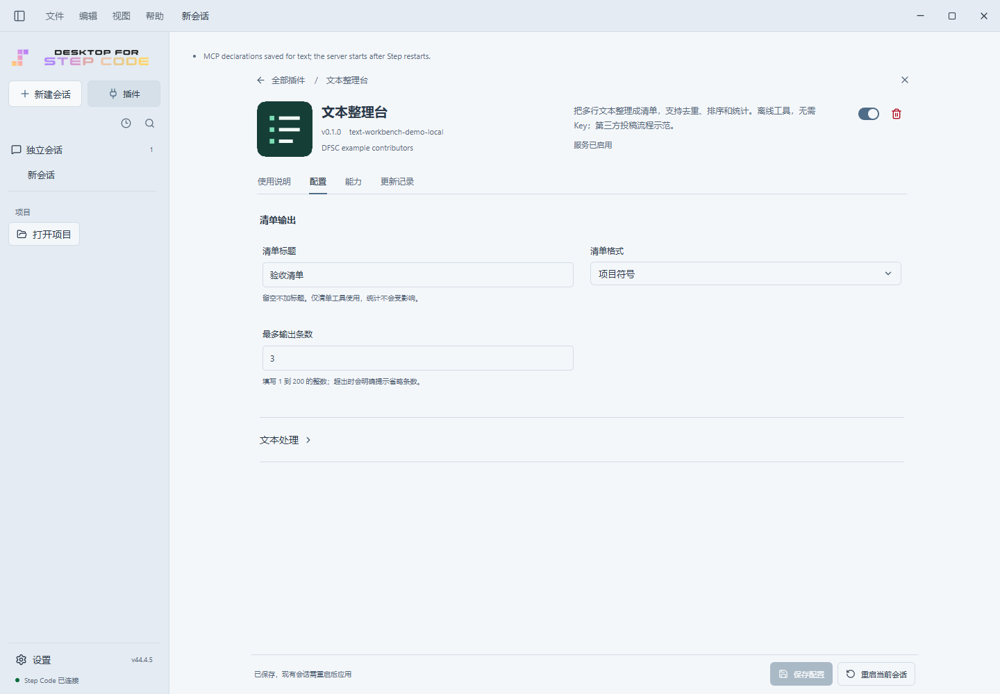

# 文本整理台：独立插件投稿示范

这是把 DFSC 公开骨架当作普通作者工具使用的完整源码目录。
不是 BVR，不增加宿主特例，不冒充已上架的第三方作品。
整个目录可独立复制到自己的项目；运行插件本身不需要 npm 安装依赖。

## 实际安装效果

下面来自隔离 DFSC 开发构建的真实安装，不是手工绘制的市场预览。
截图里的客户端版本是开发运行器版本，不代表已经发布了相同的安装包。



[发现页](screenshots/discovery.png) · [作者说明](screenshots/guide.png) ·
[深色窄布局](screenshots/configuration-dark-narrow.png)

## 本地安装

需要 PATH 上的 Node.js 22+，以及已包含插件骨架协议的 DFSC 开发构建。
已发布安装包不一定支持，不把版本号相同视为协议已可用。

1. 打开「插件 → 市场来源 → 添加市场」。
2. 填入**本 README 所在目录的绝对路径**，不是其下的 `plugins` 目录。
3. 在「发现」安装「文本整理台」。
4. 打开齿轮保存配置，重启当前会话。
5. 输入 `/tidy-text` 和多行文本，或要求调用文本整理台。

MCP 工具不联网、不调用模型；周围的聊天仍使用当前模型并可能计费。
本地添加市场只是测试来源，不是公开上架。

## 源码地图

```text
.step-plugin/marketplace.json       本地测试市场
plugins/text-workbench/
  step.plugin.json                 原生身份、MCP、技能和命令
  dfsc.plugin.json                 作者、许可证与文档页签
  dfsc.settings.json               宿主自动生成的设置表单
  assets/icon.png                  原创本地图标
  docs/GUIDE.md                    安装后显示的作者说明
  docs/SETTINGS.md                 包内相对导航
  server/configuration.mjs         公开 starter 的配置读取器原样副本
  server/text.mjs                  纯文本业务，不依赖宿主内部模块
  server/protocol.mjs              小型 stdio MCP 协议层
  server/stdio.mjs                 仅标准输入/输出，不开端口
  commands/tidy-text.md            提示命令
  skills/text-workbench/SKILL.md    工具使用边界
tests/                             纯 Node 测试与隔离验收脚本
submission/                        投稿准备清单，不是已提交的 PR
```

## 开发检查

```sh
npm test
npm run icon
npm run lock
```

不需要安装依赖。`source-lock.json` 只记录本地包文件的 SHA-256，
**不能替代公开投稿要求的真实 Git 提交 SHA**。

配置读取器复制自骨架 `config-starter/server/configuration.mjs`，
保持原样，不在插件里绕过来源、哈希、修订或撤销检查。
其原作者版权保留在插件 LICENSE 中，其余示例代码与原创图标同为 MIT。
插件没有 renderer、iframe、脚本注入或宿主账户权限。

投稿前按 [投稿清单](submission/CHECKLIST.md)准备独立仓库、
锁定提交和社区材料。未公开前省略 GitHub、视频和 Star，不填虚构信息。

本轮实际验收与宿主通用入口修复见 [验收记录](VERIFICATION.md)。
