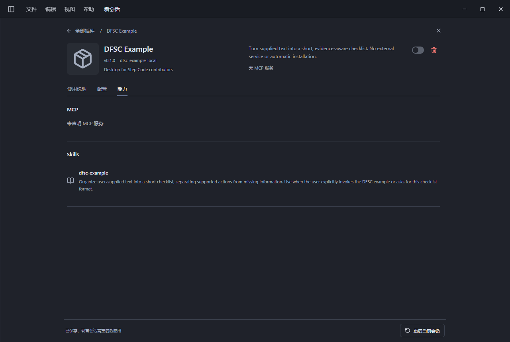

# DFSC Example

A minimal resource plugin for DFSC's native marketplace loader.
It provides one skill and the `/dfsc-example` prompt command.
It declares no MCP server, executable frontend, installer, account bridge,
network endpoint or secret. The host's service switch is therefore unavailable.

## Start Here

With a new host build that includes plugin workspaces, installation adds
Checklist workspace to the independent plugin group near MiniChat.
Open it to read the [first-use steps](docs/start.md), complete a
[small checklist task](docs/first-task.md), or resolve
[missing resources](docs/troubleshooting.md).
The workspace is host-rendered Markdown, not an executable plugin frontend.
An older build may load the skill and command without showing this new entry.
The application's version number alone does not establish feature support.

Install through the supplied local marketplace, then explicitly restart an
existing session to load the resources. Invoke `/dfsc-example <your text>`
to request a short checklist grounded in the supplied text.
Submitting the expanded prompt uses the current session model and may consume
that account's quota. Installing or viewing the resource makes no model request.
The skill is guidance, not a deterministic output guarantee.

## Installed resource

This screenshot is from the real isolated Windows Electron acceptance, showing
the native skill discovery and the correctly unavailable MCP service switch.
It predates the new desktop workspace and is not evidence of its acceptance.

Uninstall through Plugins, then reload affected sessions. There is no
plugin-owned persistent state to delete. This resource does not access other
clients' settings or credentials.

Requires a DFSC build with native resource-plugin management. This example is
validated against the local plugin-center branch, not every published version.
See the repository's examples/plugins and docs/PLUGIN_AUTHORING.md before
renaming it and submitting a pinned source to the community marketplace.

License: MIT. Copyright 2026 Desktop for Step Code contributors.
